<!--
  Every animation on this page is hand-built SVG (CSS keyframes + SMIL), generated by scripts/build.py.
  GitHub strips JavaScript from READMEs, so this is how you get motion here.
-->

  

  

  
  
  

 

  

  
  
  
  

 

  

  <picture>
    <source media="(prefers-color-scheme: dark)" srcset="https://raw.githubusercontent.com/harshilbh2005/harshilbh2005/output/snake-dark.svg" />
    <source media="(prefers-color-scheme: light)" srcset="https://raw.githubusercontent.com/harshilbh2005/harshilbh2005/output/snake-light.svg" />
    
  </picture>

 

<!--
  Add contact links here when ready, e.g.
  

    
    
  

-->
